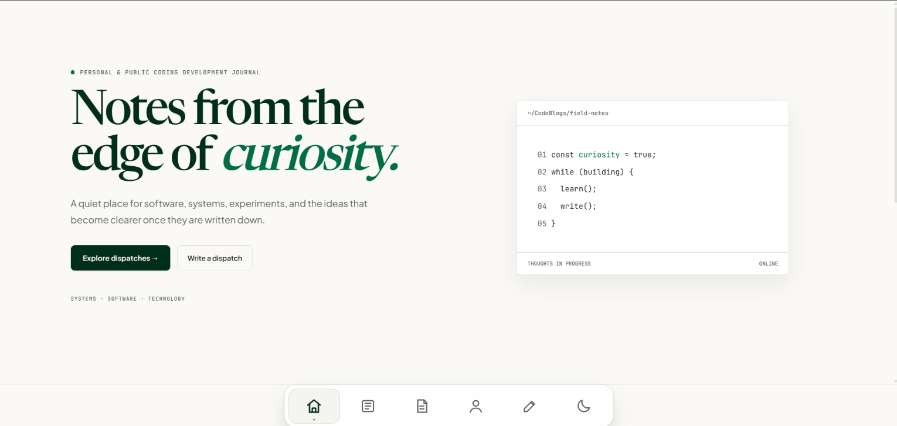
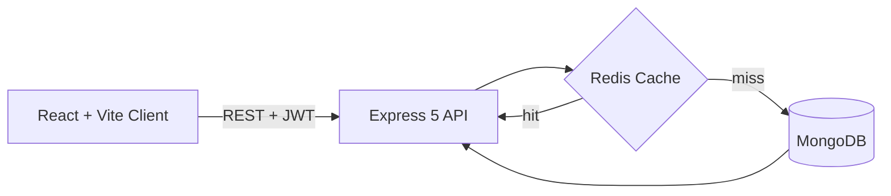
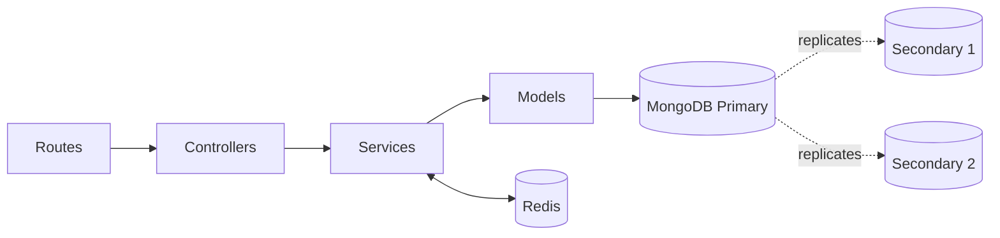
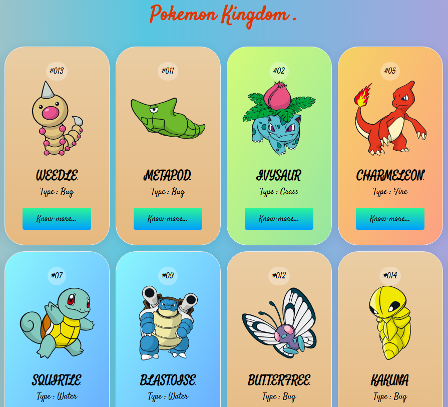
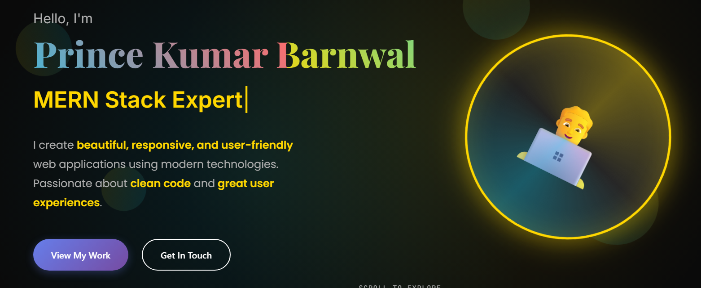
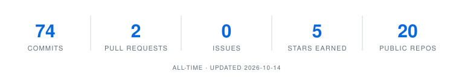

<h1 align="center">Hi, I'm Prince Kumar Barnwal 👋</h1>

<h3 align="center">Full-stack developer who ships secure, cached, tested and containerized apps React · Node.js · MongoDB · Redis · Docker · CI/CD</h3>

  
  
  
  
  

  
  
  
  

---

## 👨‍💻 About Me

B.Tech (Information Technology) graduate from MCKV Institute of Engineering. I build full-stack apps and care about the parts that make software production-ready: authentication, access control, validation, caching, tests and CI/CD.

I also compete in programming contests, where I'm **4★ on CodeChef (1829)**, a rating in the top 5000.

- 🔨 **Building:** scalable full-stack systems with caching, high availability and automated pipelines
- 🌱 **Contributing:** open source. I have a merged PR in [Kestra](https://github.com/kestra-io/kestra/pull/20485)
- 💬 **Ask me about:** JWT refresh-token rotation, Redis cache-aside, MongoDB replica sets, Dockerized Node apps
- 📫 **Open to:** internships, full-time roles and collaboration. The best way to reach me is [LinkedIn](https://www.linkedin.com/in/princekbarnwal/)

---

## 🚀 Featured Projects

### 📝 Codeblogs: secure full-stack blogging platform
[📂 Source Code](https://github.com/princekbarnwal/Codeblogs)

  

| | |
|---|---|
| 🔐 **Auth** | JWT access + refresh token flow with **rotation** and logout-based revocation (Express 5 + Mongoose) |
| 🛡️ **Security** | Tiptap rich-text editor with `sanitize-html`, Zod validation, Helmet, rate limiting |
| ⚡ **Performance** | Redis **cache-aside** pattern with write-invalidation |
| 🧪 **Quality** | Jest + Supertest test suite, containerized with Docker Compose |
| 🎨 **Frontend** | React + Vite client, dark mode, ownership-based access control |

---

### 📦 Product Catalog Service: highly-available REST API
[📂 Source Code](https://github.com/princekbarnwal/Product_catalog_service) · [🟢 Live API](https://product-catalog-service-tfcn.onrender.com/products) *(hosted on a free tier, so the first request can take up to a minute to wake the server)*

| | |
|---|---|
| 🧱 **Architecture** | Layered design: routes → controllers → services → models |
| 🗄️ **High availability** | MongoDB as a **3-node replica set** with manually tested failover |
| ⚡ **Caching** | Redis cache-aside on reads, write-invalidation on POST/PUT/DELETE |
| 🚢 **DevOps** | Docker Compose stack, Jest + Supertest tests, **GitHub Actions CI** on every push/PR |

---

### More projects

<table>
  <tr>
    <td width="50%" valign="top">
      <h4>⚡ Pokémon WebApp</h4>
      
      
React Hooks + Axios, fetching and presenting data across 1,000+ Pokémon entries from PokeAPI.

      <a href="https://pokemonwebapp-princekbarnwal.vercel.app/">Live Demo</a> · <a href="https://github.com/princekbarnwal/Pokemon_webapp">Source</a>
    </td>
    <td width="50%" valign="top">
      <h4>🌐 Portfolio Website</h4>
      
      
Responsive, component-driven React portfolio with custom styling, smooth navigation and a preloader.

      <a href="https://princekbarnwal.vercel.app/">Live Demo</a> · <a href="https://github.com/princekbarnwal/My_portfolio">Source</a>
    </td>
  </tr>
</table>

---

## 💼 Experience

**Web Developer Intern @ NTPC** · June 2025 – July 2025

- Built a responsive **Contract Closure Dashboard** managing **80+ contract records**, replacing manual spreadsheet tracking with real-time Google Apps Script CRUD integration and live data sync.
- Implemented **role-based access control** (Admin/Viewer) with secure authentication and a 30-minute session timeout to protect sensitive internal data.
- Added multi-field dynamic filtering, pagination, auto-refresh notifications, and adaptive desktop/mobile views.

---

## 🛠️ Tech Stack

**Languages**

**Frontend**

**Backend & Databases**

**DevOps, Testing & Tools**

---

## 🏆 Competitive Programming & Achievements

| | |
|---|---|
| ⭐ **CodeChef** | 4★ **(1829)**, top 5000 · [@princekb](https://www.codechef.com/users/princekb) |
| 🥇 **Contest ranks** | **Global rank 59** in a CodeChef contest; rank < 100 in 3 contests and < 200 in 7+ contests |
| 🧩 **Problem solving** | **800+** problems solved across platforms · [LeetCode @princekb](https://leetcode.com/princekb) |
| 🌍 **TCS CodeVita** | Qualified Round 2 (Global Rank 12K in Round 1, 6K in Round 2) |
| 🏅 **BrainRush 2K23** | Winner of the college-level Coding & Quiz competition |

---

## 🌱 Open Source

**[kestra-io/kestra #20485](https://github.com/kestra-io/kestra/pull/20485): refactor(executions): replace explicit `any` with real types in `TaskRunLine.vue`** · closes [#20323](https://github.com/kestra-io/kestra/issues/20323)

- Replaced **17 explicit `any`** in the execution UI component with real TypeScript types: props typed with `Execution`, `FlowForExecution` and `LogEntry`, a local `TaskRunWithOutputs` type for subflow outputs the SDK doesn't model, and callbacks that now infer their parameter types.
- Reduced the repo's explicit-`any` count from **708 to 691** and removed the file from the type-debt baseline.
- Typing surfaced a real edge case: an attempt's `endDate` and `duration` can be missing while a task is still running, so the tooltip now skips the date helpers instead of passing missing values through.
- Reviewed and approved by a Kestra maintainer, with all 16 CI checks passing.

---

## 📊 GitHub Stats

  <picture>
    <source media="(prefers-color-scheme: dark)" srcset="stats/stats-dark.svg">
    
  </picture>

  <a href="https://github.com/princekbarnwal?tab=repositories">
    <picture>
      <source media="(prefers-color-scheme: dark)" srcset="https://github-readme-stats.vercel.app/api/top-langs/?username=princekbarnwal&layout=compact&hide_border=true&hide_title=true&theme=dark&bg_color=00000000&card_width=320">
      
    </picture>
  </a>

---

## 📫 Let's Connect

I'm open to internships, full-time roles and open-source collaboration. If something here is useful or interesting, a ⭐ on a repo or a follow means a lot.

[LinkedIn](https://www.linkedin.com/in/princekbarnwal/) · [Portfolio](https://princekbarnwal.vercel.app/) · [CodeChef](https://www.codechef.com/users/princekb) · [LeetCode](https://leetcode.com/princekb)

<i>"Great code is written twice: once in logic, once in purpose."</i>
